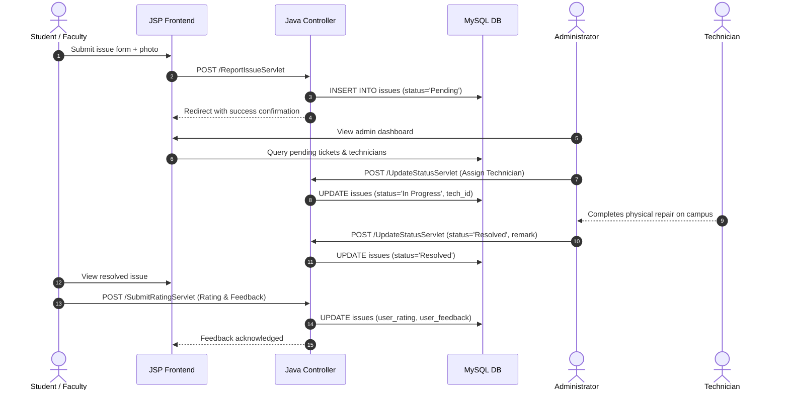

<div align="center">

# 🏫 CampusCare
### Smart Campus Facility Management & Grievance Redressal System

[](https://www.oracle.com/java/)
[](https://javaee.github.io/servlet-spec/)
[](https://tomcat.apache.org/)
[](https://www.mysql.com/)
[](https://opensource.org/licenses/MIT)
[](CONTRIBUTING.md)

<p align="center">
  A robust, full-stack Java web application engineered to streamline campus facility complaints, technician dispatch, issue lifecycle tracking, and administrative governance for universities and educational institutions.
</p>

[Explore Documentation](docs/ARCHITECTURE.md) • [Database Setup](database/README.md) • [Report Bug](https://github.com/aibinjmca2527-dotcom/CampusCare/issues) • [Request Feature](https://github.com/aibinjmca2527-dotcom/CampusCare/issues)

</div>

---

## 📑 Table of Contents

- [About CampusCare](#-about-campuscare)
- [Key Features](#-key-features)
  - [Student & Faculty Portal](#1-student--faculty-portal)
  - [Administrative Command Center](#2-administrative-command-center)
  - [Technician & Dispatch Management](#3-technician--dispatch-management)
- [System Architecture](#-system-architecture)
- [Technology Stack](#-technology-stack)
- [Project Structure](#-project-structure)
- [Getting Started](#-getting-started)
  - [Prerequisites](#prerequisites)
  - [Step 1: Clone Repository](#step-1-clone-the-repository)
  - [Step 2: Database Initialization](#step-2-database-initialization)
  - [Step 3: Database Configuration](#step-3-database-configuration)
  - [Step 4: Email Setup (Optional)](#step-4-email-setup-optional)
  - [Step 5: Build and Run](#step-5-build-and-run)
- [Default Credentials](#-default-credentials)
- [Troubleshooting & FAQ](#-troubleshooting--faq)
- [Contributing](#-contributing)
- [Security](#-security)
- [License](#-license)

---

## 💡 About CampusCare

Campus facilities—laboratories, lecture halls, electrical fixtures, networking equipment, and plumbing—require prompt maintenance to support educational continuity. Traditional methods such as verbal requests, register logbooks, or disconnected emails result in neglected tickets, lack of accountability, and delayed resolutions.

**CampusCare** solves this by establishing a centralized, transparent platform where:
1. **Students & Faculty** easily report issues with physical locations and optional photo evidence.
2. **Administrators** inspect real-time statistics, review complaints, assign designated trade technicians, and update progress.
3. **Technicians** receive structured issue details for targeted physical repairs.
4. **Users** rate the quality of service with 1–5 star reviews and qualitative feedback once resolved.

---

## ✨ Key Features

### 1. Student & Faculty Portal
- 📝 **Frictionless Issue Reporting**: File complaints categorized under *IT & Network*, *Electrical*, *Plumbing*, *Infrastructure*, *Cleanliness*, or *Other*.
- 📸 **Photo Evidence Uploads**: Upload JPEG/PNG images illustrating the defect; served safely via isolated image streaming.
- ⏱️ **Real-Time Ticket Tracking**: Monitor progress through colored lifecycle badges (`Pending`, `In Progress`, `Resolved`, `Rejected`).
- ⭐ **Satisfaction Rating & Feedback**: Rate completed repairs from 1 to 5 stars and submit feedback directly on the dashboard.
- 🔑 **Automated Password Reset**: Self-service temporary password dispatch via JavaMail SMTP integration.
- 👤 **Profile Customization**: Update display names, department tags, passwords, and profile photos.

### 2. Administrative Command Center
- 📊 **Executive Analytics Dashboard**: Live metrics summarizing Total, Pending, In Progress, and Resolved complaints alongside categorical distribution.
- 🛠️ **Issue Lifecycle Management**: Update ticket states, record official administrative remarks, and dispatch trade technicians.
- 🚫 **Spam Protection & User Governance**: One-click banning mechanism to restrict disruptive accounts while preserving audit records.
- 👥 **User Management Directory**: Search and monitor registered campus members and their total filing history.

### 3. Technician & Dispatch Management
- 👷 **Specialist Directory**: Maintain a roster of on-campus technicians mapped to specific maintenance domains.
- 📞 **Direct Contact Integration**: Click-to-call phone linking for fast field coordination.
- 🔄 **Active/Inactive Status**: Toggle availability based on work shifts and leave status.

---

## 🏛️ System Architecture

CampusCare follows the **Model-View-Controller (MVC)** architectural pattern to maintain clean separation of concerns:

```
  ┌──────────────┐         HTTP POST / GET         ┌──────────────────────┐
  │   Browser    │ ──────────────────────────────> │    Java Servlets     │
  │ (JSP / CSS)  │ <────────────────────────────── │     (Controller)     │
  └──────────────┘           HTML / Redirect       └──────────┬───────────┘
         ▲                                                    │
         │                                                    │ Uses / Modifies
         │ Renders                                            ▼
  ┌──────────────┐                                 ┌──────────────────────┐
  │  JSP Views   │ <────────────────────────────── │      Java Models     │
  │  with JSTL   │           State Data            │ (User, Issue, Tech)  │
  └──────────────┘                                 └──────────┬───────────┘
                                                              │
                                                              │ JDBC Queries
                                                              ▼
                                                   ┌──────────────────────┐
                                                   │   MySQL Database     │
                                                   │   (campuscare_db)    │
                                                   └──────────────────────┘
```

### Complaint Lifecycle Sequence



---

## 💻 Technology Stack

| Component | Technology | Description |
|-----------|------------|-------------|
| **Language** | Java (JDK 8 / 11 / 17+) | Core server-side programming language |
| **Server Engine** | Apache Tomcat 9.0 / 10.1+ | Servlet & JSP container |
| **Architecture** | Java Servlets (Java EE / Jakarta) | Controller layer handling routing and business logic |
| **Presentation** | JSP 2.3 + JSTL 1.2 | Dynamic server-side templating |
| **Styling** | Vanilla Modern CSS3 | Custom emerald design system, Inter typography, responsive grid |
| **Database** | MySQL 8.0+ | Relational data persistence with foreign key constraints |
| **Connectivity** | MySQL Connector/J 8.x | Official JDBC Type 4 driver |
| **Mailing** | JavaMail API 1.6 + Java Activation | SMTP dispatch for forgot password workflow |
| **Build Tools** | Apache Ant / NetBeans IDE | Standard Java Web Project build configuration |

---

## 📂 Project Structure

```
CampusCare/
├── .github/                         # GitHub issue templates and PR guidelines
│   ├── ISSUE_TEMPLATE/
│   │   ├── bug_report.md
│   │   └── feature_request.md
│   └── pull_request_template.md
├── database/                        # Database scripts and documentation
│   ├── README.md                    # Database documentation & ERD diagram
│   ├── schema.sql                   # Table DDL, keys, and constraints
│   └── seed.sql                     # Initial seed accounts & demo issues
├── docs/                            # Deep-dive architecture and design guides
│   └── ARCHITECTURE.md              # Technical specifications & security model
├── nbproject/                       # NetBeans IDE project metadata
├── src/java/com/campuscare/         # Java backend source code
│   ├── db/
│   │   └── DBConnection.java        # JDBC connection factory with env support
│   ├── model/                       # Plain Old Java Objects (Data Models)
│   │   ├── Issue.java               # Issue entity representation
│   │   ├── Technician.java          # Technician entity representation
│   │   └── User.java                # User entity representation
│   ├── servlet/                     # HTTP Servlet Controllers
│   │   ├── AdminUserStatusServlet.java
│   │   ├── DeleteIssueServlet.java
│   │   ├── DeleteUserServlet.java
│   │   ├── ForgotPasswordServlet.java
│   │   ├── ImageServlet.java
│   │   ├── LoginServlet.java
│   │   ├── LogoutServlet.java
│   │   ├── RegisterServlet.java
│   │   ├── ReportIssueServlet.java
│   │   ├── SubmitRatingServlet.java
│   │   ├── TechnicianServlet.java
│   │   ├── UpdateProfileServlet.java
│   │   └── UpdateStatusServlet.java
│   └── util/                        # Shared utility classes
│       ├── MailConfig.java          # SMTP configuration loader
│       ├── SimpleSmtpMail.java      # JavaMail transmission wrapper
│       └── UploadUtil.java          # File storage location resolver
├── web/                             # Web application presentation root
│   ├── css/
│   │   └── style.css                # Master responsive stylesheet
│   ├── images/                      # Static branding assets
│   ├── includes/                    # Reusable JSP navigation bars
│   │   ├── admin-nav.jsp
│   │   └── user-nav.jsp
│   ├── videos/                      # Demonstration & tutorial media
│   ├── WEB-INF/
│   │   ├── EMAIL_SETUP.txt          # SMTP setup documentation
│   │   ├── email.properties.example # SMTP credentials template
│   │   ├── lib/                     # Bundled dependencies (JARs)
│   │   │   ├── javax.activation.jar
│   │   │   ├── javax.mail.jar
│   │   │   ├── jstl-1.2.jar
│   │   │   └── mysql-connector-j.jar
│   │   └── web.xml                  # Web application descriptor
│   ├── admin-dashboard.jsp          # Admin issue overview & dispatcher
│   ├── admin-profile.jsp            # Admin profile editor
│   ├── admin-technicians.jsp        # Maintenance staff roster
│   ├── admin-users.jsp              # User management & account controls
│   ├── forgot-password.jsp          # Password reset request page
│   ├── index.jsp                    # Public landing page with live statistics
│   ├── login.jsp                    # Secure sign-in form
│   ├── my-complaints.jsp            # User complaint history & feedback
│   ├── profile.jsp                  # User profile & credentials editor
│   ├── register.jsp                 # Student & faculty registration form
│   ├── report-issue.jsp             # Complaint submission form
│   └── user-dashboard.jsp           # User dashboard & summary cards
├── .gitignore                       # Ignored build outputs and sensitive secrets
├── build.xml                        # Apache Ant build script
├── CampusCare.sql                   # Consolidated single-file database setup
├── CODE_OF_CONDUCT.md               # Contributor Covenant Code of Conduct
├── CONTRIBUTING.md                  # Development and PR guidelines
├── LICENSE                          # MIT Open-Source License
├── README.md                        # Project documentation (this file)
└── SECURITY.md                      # Security vulnerability reporting policy
```

---

## 🚀 Getting Started

Follow these instructions to set up CampusCare on your local development machine.

### Prerequisites

Ensure you have the following software installed:
- **Java Development Kit (JDK)**: Version 8, 11, or 17 ([Download](https://www.oracle.com/java/technologies/downloads/))
- **Apache Tomcat**: Version 9.0.x or 10.x ([Download](https://tomcat.apache.org/download-90.cgi))
- **MySQL Server**: Version 8.0 or newer ([Download](https://dev.mysql.com/downloads/mysql/))
- **NetBeans IDE** (Recommended) or IntelliJ IDEA / Eclipse for Java EE ([Download NetBeans](https://netbeans.apache.org/))

---

### Step 1: Clone the Repository

```bash
git clone https://github.com/aibinjmca2527-dotcom/CampusCare.git
cd CampusCare
```

---

### Step 2: Database Initialization

1. Open your terminal or MySQL command line client:
   ```bash
   mysql -u root -p
   ```
2. Execute the consolidated setup file:
   ```sql
   source CampusCare.sql;
   ```
   *(Alternatively, run `database/schema.sql` followed by `database/seed.sql`, or import `CampusCare.sql` in **MySQL Workbench** or **phpMyAdmin**).*

This creates the `campuscare_db` database, initializes all required tables, and loads seed accounts.

---

### Step 3: Database Configuration

By default, CampusCare connects to:
- **Host**: `localhost:3306`
- **Database**: `campuscare_db`
- **User**: `root`
- **Password**: *(empty)*

If your local MySQL uses a different username or password, you can either:
- **Option A (Environment Variables - Recommended)**:
  ```bash
  export DB_URL="jdbc:mysql://localhost:3306/campuscare_db?useSSL=false&serverTimezone=UTC&allowPublicKeyRetrieval=true"
  export DB_USER="your_username"
  export DB_PASSWORD="your_password"
  ```
- **Option B (Direct Configuration)**:
  Update the connection credentials in [`src/java/com/campuscare/db/DBConnection.java`](src/java/com/campuscare/db/DBConnection.java).

---

### Step 4: Email Setup (Optional)

To enable automatic password reset emails:
1. Copy the example properties template:
   ```bash
   cp web/WEB-INF/email.properties.example web/WEB-INF/email.properties
   ```
2. Edit `web/WEB-INF/email.properties` with your SMTP account details:
   ```properties
   mail.enabled=true
   mail.smtp.host=smtp.gmail.com
   mail.smtp.port=587
   mail.smtp.starttls=true
   mail.smtp.username=your_email@gmail.com
   mail.smtp.password=your_16_character_app_password
   mail.from=CampusCare <your_email@gmail.com>
   ```
> ⚠️ **Note**: For Gmail, use an **App Password** generated from [Google Account Security](https://myaccount.google.com/apppasswords), not your regular password. Keep `email.properties` secret—it is automatically ignored by `.gitignore`.

---

### Step 5: Build and Run

#### Using NetBeans IDE (Easiest)
1. Launch **NetBeans IDE**.
2. Click **File** ➔ **Open Project...** and select the `CampusCare` folder.
3. Right-click the project name in the Projects tab and select **Resolve Missing Server / Libraries** if prompted to link your local Tomcat instance.
4. Right-click the project and choose **Clean and Build**.
5. Click **Run Project** (or press `F6`). NetBeans will automatically deploy the WAR and open your browser at:
   ```
   http://localhost:8080/CampusCare/
   ```

#### Using Command Line / Ant
```bash
ant clean dist
# Copy the resulting .war from dist/ to your Tomcat webapps directory:
cp dist/CampusCare.war /path/to/tomcat/webapps/
```

---

## 🔑 Default Credentials

The database seed includes pre-configured accounts for testing:

| Role | Email Address | Password | Privileges |
|------|---------------|----------|------------|
| **System Administrator** | `admin@campuscare.com` | `admin123` | Full dashboard access, ticket dispatch, user management, technician roster |
| **Student (Alex Rivera)** | `alex.rivera@campuscare.com` | `user123` | Report complaints, track progress, review resolved tickets |
| **Student (Priya Sharma)** | `priya.sharma@campuscare.com` | `user123` | Report complaints, track progress |
| **Student (Marcus Vance)** | `marcus.vance@campuscare.com` | `user123` | Report complaints, track progress |

> 💡 *You can also create a new student or faculty account at any time via the **Register** page.*

---

## ❓ Troubleshooting & FAQ

### 1. `SQLException: Access denied for user 'root'@'localhost'`
- Verify that your MySQL server is running.
- Ensure the password set in `DBConnection.java` or the `DB_PASSWORD` environment variable matches your local MySQL `root` account.

### 2. `ClassNotFoundException: com.mysql.cj.jdbc.Driver`
- Verify that `web/WEB-INF/lib/mysql-connector-j.jar` is present in your build output and included under project libraries in your IDE.

### 3. File upload errors when attaching complaint images
- Ensure the target upload directory has write permissions. By default, uploads are stored in Tomcat's `catalina.base/campuscare_uploads` or `~/campuscare_uploads`. You can specify a custom absolute directory in `web/WEB-INF/web.xml` under `<context-param>uploadDir</context-param>`.

### 4. `Could not send reset email: AuthenticationFailedException`
- Ensure 2-Step Verification is enabled on your Gmail account.
- Use a dedicated 16-character **App Password**, not your normal login password.

---

## 🤝 Contributing

Contributions make the open-source community a fantastic place to learn, inspire, and create. Any contributions you make are **greatly appreciated**.

Please review our [Contributing Guidelines](CONTRIBUTING.md) and [Code of Conduct](CODE_OF_CONDUCT.md) before submitting pull requests.

1. Fork the Project
2. Create your Feature Branch (`git checkout -b feature/AmazingFeature`)
3. Commit your Changes (`git commit -m 'feat: Add AmazingFeature'`)
4. Push to the Branch (`git push origin feature/AmazingFeature`)
5. Open a Pull Request

---

## 🔒 Security

For security vulnerability disclosures, please review our [Security Policy](SECURITY.md). Do not submit security-sensitive issues to public channels.

---

## 📄 License

Distributed under the **MIT License**. See [`LICENSE`](LICENSE) for full details.

---

<div align="center">
  <sub>Built with ❤️ for better campus environments by <a href="https://github.com/aibinjmca2527-dotcom">Aibin Joseph</a></sub>
</div>
