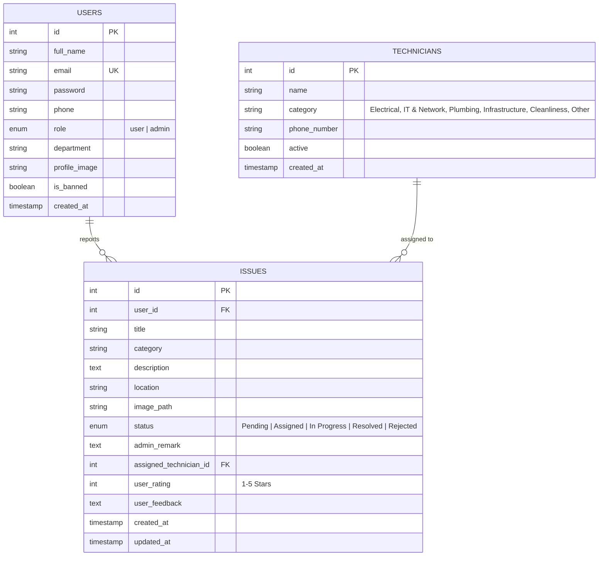

# 🗄️ CampusCare – Database Documentation & Setup Guide

This directory contains the database definition, schema scripts, and seed fixtures for the **CampusCare** smart campus issue tracking and facility management platform.

---

## 📁 Directory Contents

| File | Purpose |
|------|---------|
| [`schema.sql`](file:///c:/sdg_project/CampusCare1/database/schema.sql) | DDL script defining tables (`users`, `technicians`, `issues`), constraints, foreign keys, and indexes. |
| [`seed.sql`](file:///c:/sdg_project/CampusCare1/database/seed.sql) | Fixtures providing default administrator account, demo student accounts, technicians across 6 trade categories, and sample issues across all lifecycle states. |
| [`CampusCare.sql`](file:///c:/sdg_project/CampusCare1/CampusCare.sql) | Consolidated single-file database setup (Schema + Seed) located at project root for one-click import in MySQL Workbench or phpMyAdmin. |

---

## 🚀 Quick Setup Instructions

### Option 1: Using MySQL Command Line (CLI)

```bash
# Log in and execute the consolidated setup file
mysql -u root -p < ../CampusCare.sql
```

Or execute schema and seed separately:

```bash
mysql -u root -p < schema.sql
mysql -u root -p < seed.sql
```

### Option 2: Using MySQL Workbench

1. Launch **MySQL Workbench** and connect to your local MySQL instance.
2. Go to **File** ➔ **Open SQL Script...**
3. Select `CampusCare.sql` (or `database/schema.sql` followed by `database/seed.sql`).
4. Click the **Execute** button (⚡ icon).
5. In the Schemas panel on the left, right-click and click **Refresh All** to confirm `campuscare_db` is created.

### Option 3: Using phpMyAdmin

1. Open `http://localhost/phpmyadmin` in your web browser.
2. Click the **Import** tab in the top navigation bar.
3. Browse and select `CampusCare.sql`.
4. Click **Go** at the bottom to execute.

---

## 📊 Entity Relationship Diagram (ERD)



---

## 🔑 Default Accounts

| Role | Email | Password | Purpose |
|------|-------|----------|---------|
| **System Administrator** | `admin@campuscare.com` | `admin123` | Full dashboard access, ticket dispatch, user management |
| **Student (Alex Rivera)** | `alex.rivera@campuscare.com` | `user123` | Student portal, report issues, submit ratings |
| **Student (Priya Sharma)** | `priya.sharma@campuscare.com` | `user123` | Student portal, report issues |
| **Student (Marcus Vance)** | `marcus.vance@campuscare.com` | `user123` | Student portal, report issues |
