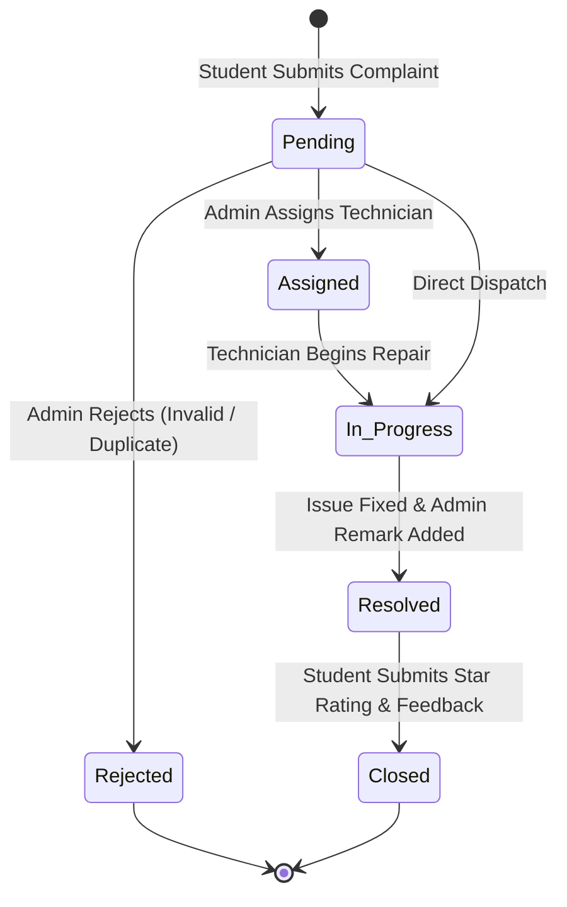

# 🏛️ CampusCare Architecture & Technical Design

This document details the software architecture, design patterns, data flow, and security considerations of **CampusCare**.

---

## 📌 System Overview

CampusCare is designed as an enterprise-grade, lightweight web application built upon standard **Java Enterprise Edition (Jakarta/Java EE)** technologies, following the classic **Model-View-Controller (MVC)** architectural pattern.

```
       ┌────────────────────────────────────────────────────────┐
       │                   Client Browser                       │
       └───────────────────────────┬────────────────────────────┘
                                   │ HTTP Requests / JSP Views
                                   ▼
       ┌────────────────────────────────────────────────────────┐
       │             Apache Tomcat Web Container                │
       │                                                        │
       │  ┌────────────────────────┐  ┌──────────────────────┐  │
       │  │ Controller (Servlets)  │  │    View (JSP/JSTL)   │  │
       │  │ Login, ReportIssue,    │  │ admin-dashboard,     │  │
       │  │ UpdateStatus, etc.     │  │ user-dashboard, etc. │  │
       │  └────────────┬───────────┘  └───────────▲──────────┘  │
       │               │                          │             │
       │               ▼                          │             │
       │  ┌───────────────────────────────────────┴──────────┐  │
       │  │             Model & Utilities Layer              │  │
       │  │ Issue, User, Technician, UploadUtil, MailConfig  │  │
       │  └────────────────────────┬─────────────────────────┘  │
       └───────────────────────────┼────────────────────────────┘
                                   │ JDBC
                                   ▼
       ┌────────────────────────────────────────────────────────┐
       │                      MySQL RDBMS                       │
       │       users  │  technicians  │  issues tables          │
       └────────────────────────────────────────────────────────┘
```

---

## 🧩 Architectural Layers

### 1. Presentation Layer (View)
- **Technology**: JavaServer Pages (JSP) 2.3, JSTL 1.2, HTML5, Vanilla CSS3 (Custom Design System with Inter typography and responsive flex/grid layouts), FontAwesome 6 icons.
- **Components**:
  - `index.jsp`: Landing portal with dynamic live statistics, project overview, and feature highlights.
  - `login.jsp` & `register.jsp`: Authentication entry points with validation.
  - `user-dashboard.jsp`: Student/faculty workspace displaying ticket status metrics, urgent feedback reminders, and recent tickets.
  - `report-issue.jsp`: Multi-part issue submission form supporting title, category, description, campus location, and image attachment.
  - `my-complaints.jsp`: Filterable complaints table with status badges, assigned technician details, and interactive rating modals.
  - `admin-dashboard.jsp`: Executive dashboard with statistical cards, category distribution, issue modal dialogs, and technician dispatching.
  - `admin-technicians.jsp`: Maintenance personnel registry with CRUD management and direct calling capabilities.
  - `admin-users.jsp`: User directory with account status controls and ban enforcement.

### 2. Controller Layer (Servlets)
- **Technology**: Java Servlets (`javax.servlet.http.HttpServlet`) mapped via `@WebServlet` annotations.
- **Responsibilities**:
  - Request validation and parameter sanitization.
  - Session verification and Role-Based Access Control (RBAC).
  - Business logic orchestration.
  - Forwarding to JSP views or redirecting to avoid double-submission (PRG pattern).

| Servlet | Mapping | Responsibility |
|---------|---------|----------------|
| `LoginServlet` | `/LoginServlet` | Authenticates credentials, verifies ban status, assigns session attributes. |
| `LogoutServlet` | `/LogoutServlet` | Invalidates active HTTP session and redirects to login. |
| `RegisterServlet` | `/RegisterServlet` | Registers new student/faculty accounts with duplicate email validation. |
| `ForgotPasswordServlet` | `/ForgotPasswordServlet` | Generates secure temporary password and dispatches via JavaMail SMTP. |
| `ReportIssueServlet` | `/ReportIssueServlet` | Parses multipart form data, validates file upload types, inserts issue record. |
| `UpdateStatusServlet` | `/UpdateStatusServlet` | Admin-only workflow updating issue status, remarks, technician assignment, or banning users. |
| `SubmitRatingServlet` | `/SubmitRatingServlet` | Stores user satisfaction ratings (1–5 stars) and textual feedback upon ticket resolution. |
| `TechnicianServlet` | `/TechnicianServlet` | Admin CRUD controller for on-campus maintenance technicians. |
| `AdminUserStatusServlet` | `/AdminUserStatusServlet` | Controls student ban/unban status. |
| `DeleteUserServlet` | `/DeleteUserServlet` | Deletes standard user accounts (protects administrator accounts). |
| `DeleteIssueServlet` | `/DeleteIssueServlet` | Allows users to withdraw their own complaints. |
| `UpdateProfileServlet` | `/UpdateProfileServlet` | Updates name, password, and profile avatar. |
| `ImageServlet` | `/ImageServlet` | Streams uploaded complaint photos safely from outside the webapp root. |

### 3. Model & Data Access Layer
- **POJOs / Beans**:
  - `com.campuscare.model.User`: Encapsulates user entity state.
  - `com.campuscare.model.Issue`: Encapsulates issue tracking entity state.
  - `com.campuscare.model.Technician`: Encapsulates maintenance technician profile.
- **Data Access (`DBConnection`)**:
  - Uses standard JDBC `PreparedStatement` across all queries to prevent SQL injection.
  - Provides configurable database URLs and credentials via environment variables (`DB_URL`, `DB_USER`, `DB_PASSWORD`) and JVM properties.

---

## 🔄 Complaint Lifecycle & State Machine



---

## 🔐 Security Architecture

1. **Role-Based Access Control (RBAC)**:
   - Protected admin routes verify `session.getAttribute("userRole") == "admin"`.
   - Protected user routes verify `session.getAttribute("userId") != null`.
   - Non-authenticated requests are immediately redirected to `login.jsp`.

2. **SQL Injection Defense**:
   - Zero string concatenation in dynamic queries.
   - 100% of queries use parameterized `PreparedStatement`.

3. **Secure File Upload Strategy**:
   - Uploaded files are strictly restricted to image mime types (`.jpg`, `.jpeg`, `.png`).
   - Files are renamed using cryptographic UUIDs (`issue_<uuid>.ext`) to prevent path traversal attacks.
   - Files are stored outside the public document root via `UploadUtil` and served strictly through `ImageServlet`.

4. **Credential Isolation**:
   - Database credentials allow override via system environment variables.
   - SMTP configuration is isolated in git-ignored `email.properties`.
